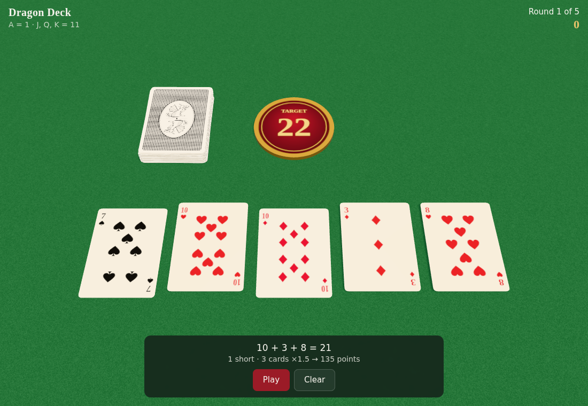

# Deck-of-52

A simple 3D maths card game, played with a 3D deck of 52 playing cards with a dragon medallion on the back (the "Dragon Deck"), made with [three.js](https://threejs.org).

## Play

Open `index.html` in a browser (it needs an internet connection to load three.js).

A target number appears, then five cards are dealt. Tap 2 to 5 cards to add them up, getting as close to the target as you can **without going over**, then press **Play**.

- **Card values:** Ace = 1, number cards = their number, Jack, Queen and King = 11
- **Closeness:** hitting the target exactly is worth 100; every point short costs 10; going over isn't allowed
- **More cards, more points:** the closeness score is multiplied by ×1 for 2 cards, ×1.5 for 3, ×2 for 4 and ×3 for all 5
- A game is 5 rounds. After each play you see the best play that was possible, and your best game score is remembered.

The numbers above all live in `rules.js`, so they're easy to tweak.

## Sandbox

`sandbox.html` is the original deck demo: shuffle, deal, fan, show all, gather, and tap a card to flip it.
`art-preview.html` shows every card picture flat, for checking the artwork.

## How it's made

| File | What it does |
| --- | --- |
| `cardArt.js` | Paints each card face and the back onto a 2D canvas |
| `artwork.js` | The 12 court card pictures and the card back (public-domain artwork by Adrian Kennard, with dragons added — see `CREDITS.md`) |
| `table.js` | The shared 3D table: turns those pictures into textures on thin rounded card models, and moves, flips and shuffles them |
| `rules.js` | The game rules and scoring, with no 3D in them |
| `rules.test.js` | Checks the rules (`node rules.test.js`) |
| `index.html` | The game: target token, dealing, picking cards, scoring |
| `sandbox.html` | The deck demo page |
| `art-preview.html` | A flat sheet of all the card art |
| `previews/` | Screenshots |
| `CREDITS.md` | Where the court card artwork comes from, and its licence |
